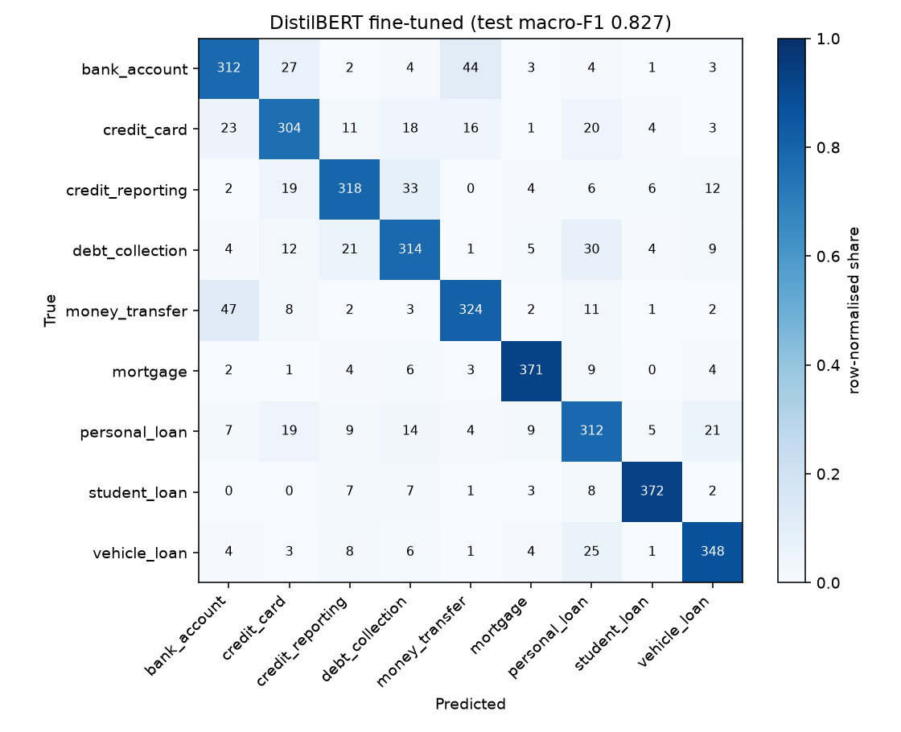

# Complaint Triage - fine-tuned DistilBERT vs TF-IDF baseline, served with FastAPI

A bank gets thousands of free-text complaints and has to send each one to the right product team. I built a
9-class router on real US consumer-finance complaints, compared a classic TF-IDF + logistic-regression baseline
with a fine-tuned DistilBERT, and served the model behind a FastAPI endpoint.

**Headline:** on 3,600 held-out complaints, fine-tuned DistilBERT reached **macro-F1 0.827** vs **0.812** for the
TF-IDF baseline. It's a real but modest gain; most remaining errors are between products that overlap in practice.

## Data
[CFPB Consumer Complaint Database](https://www.consumerfinance.gov/data-research/consumer-complaints/)
(US government, public domain; personal details are already redacted as `XXXX`).
- Complaints with a narrative received from 2023-01-01 (latest seen: 2024-02-09): 483,499.
- After merging product names into 9 classes, dropping very short texts and duplicates: 338,960.
- Balanced sample: 4,000 per class = **36,000** (28,800 train / 3,600 val / 3,600 test, stratified, seed 42).
  The class mapping is in `reports/data_summary.json`.

Classes: bank account, credit card, credit reporting, debt collection, money transfer, mortgage, personal loan,
student loan, vehicle loan.

## Approach
1. **Baseline:** TF-IDF on word and character n-grams + logistic regression (balanced class weights).
2. **Transformer:** `distilbert-base-uncased` fine-tuned in PyTorch for 3 epochs (max length 256, batch 16,
   lr 5e-5, fp16) on a 4 GB RTX 3050 laptop GPU, about 72 minutes. The checkpoint was chosen on validation macro-F1.
3. **Evaluation:** macro-F1, accuracy, per-class F1 and confusion matrices on the untouched test split, plus an
   error analysis of the most-confused pairs (`src/error_analysis.py`).
4. **Serving:** FastAPI `POST /predict {"text": ...}` returns the label, class probabilities and model version;
   `GET /health`. If the fine-tuned weights aren't present (they're too big for git), the API falls back to the
   baseline model.

## Results
All numbers come from [`reports/metrics.json`](reports/metrics.json).

| Model | Test macro-F1 | Test accuracy |
|---|---|---|
| TF-IDF + logistic regression | 0.812 | 0.812 |
| **DistilBERT (fine-tuned)** | **0.827** | **0.826** |

Per-class test F1 (baseline → DistilBERT): bank account 0.743 → 0.779, personal loan 0.716 → 0.756,
vehicle loan 0.839 → 0.866, money transfer 0.800 → 0.816, student loan 0.927 → 0.937, credit reporting
0.808 → 0.813, credit card 0.762 → 0.767, mortgage 0.931 → 0.925, debt collection 0.784 → 0.780.



**Where it goes wrong** (625 errors out of 3,600, see `reports/error_analysis.json`):
- Bank account ↔ money transfer is the biggest confusion (47 + 44). Many complaints are about a transfer
  *between the customer's own accounts*, and consumers file them under either product.
  Example: a complaint about an internal savings-to-CD transfer is labelled "money transfer". Both models
  said "bank account", and I'd argue that's a reasonable call.
- Credit reporting ↔ debt collection (33 + 21): a debt collector reporting a debt to a credit bureau is both.
- Vehicle loan ↔ personal loan (25 + 21): title loans and car-backed personal loans sit on the line.

So part of the ceiling here is label ambiguity, not just the model. A real deployment would route the
low-confidence cases to a person, or let a complaint belong to two teams.

## What I'd do next
- Measure accuracy against a confidence threshold, so the low-confidence share goes to a human.
- Try a larger model only if it beats the baseline by more than the label noise.
- Build and push the Docker image from CI.

## How to run
```bash
python -m venv .venv && .venv/Scripts/activate
pip install -r requirements.txt -r requirements-dev.txt     # API + tests
python scripts/download_data.py                              # CFPB data -> data/
pip install -r requirements-train.txt                        # PyTorch + transformers (training only)
python scripts/rebuild_models.py                             # baseline + DistilBERT -> models/
uvicorn api.main:app --reload                                # POST http://127.0.0.1:8000/predict
pytest -q
```
A `Dockerfile` and a GitHub Actions workflow (ruff + pytest on the baseline path) are included. I haven't built
the Docker image locally because Docker isn't installed on my machine.

Data: CFPB, public domain. Code: MIT.
